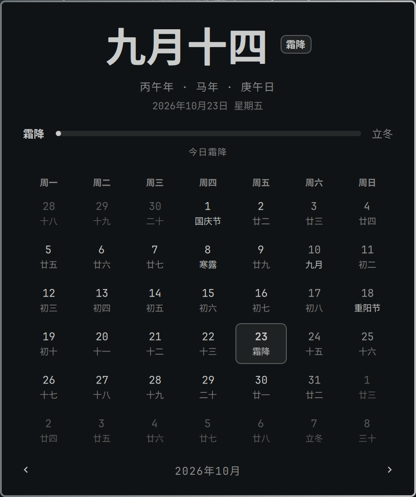

# Lunar Calendar · 农历

The Chinese lunar date and the 24 solar terms in the Omarchy bar, with a
month calendar that marks every lunar day, solar term, and festival.



- **Bar label**: today's lunar date, with the solar term or festival added on
  the day (`九月十四 · 霜降`)
- **Calendar**: each day shows its lunar day under the Gregorian number;
  festivals and solar terms are highlighted, and the first of each lunar
  month shows the month's name
- **Day details**: click any day for its lunar date, the sexagenary year,
  zodiac animal, and day (`丙午年 · 马年 · 庚午日`)
- **Solar term rail**: the last term, the next, and how far along you are
  between them (`距立冬还有 15 天`)
- **Festivals**: 春节, 元宵, 龙抬头, 端午, 七夕, 中元, 中秋, 重阳, 腊八,
  小年, 除夕, plus 元旦, 国庆, 教师节, Mother's and Father's Day, and more

### Accuracy

Covers 1900–2100. Lunar months, leap months, and solar terms (China Standard
Time) come from a compact table in `Data.js`, generated from
[lunar-javascript](https://github.com/6tail/lunar-javascript) and then
checked against it **day by day for all 73,384 days in range: lunar date,
leap month, solar term, year and day stems and branches, zodiac, and New
Year's Eve all match**. Dates outside the range show no lunar label rather
than a guess.

## Install

```bash
omarchy plugin add https://github.com/Wenston-dev/omarchy-lunar --enable
```

The widget goes beside the clock by default.

## Use

- **Left click** the label to open the calendar, **right click** to cycle it:
  `九月十四` → `丙午马年 九月十四` → `十四`
- In the calendar: arrow keys move the picked day, `[` / `]` or the scroll
  wheel step months, `T` or Enter (or clicking the big date) goes back to
  today, **Esc** closes it

## Settings

Stored on the plugin's entry in `~/.config/omarchy/shell.json`.

| Key         | Values                | Default  |
|-------------|-----------------------|----------|
| `format`    | `md`, `ymd`, `day`    | `md`     |
| `weekStart` | `monday`, `sunday`    | `monday` |

The plugin makes no network requests, runs no commands, and has no runtime
dependencies beyond Omarchy itself.

## Remove

```bash
omarchy plugin remove io.github.wenston-dev.lunar
```

## 中文说明

在顶栏显示今天的农历日期，逢节气或节日会一并标出。点开是一个农历月历：
每天都标着农历日，节日和节气用强调色标出，每月初一显示月名。点任意一天
可以看它的干支、生肖和日干支，上方的进度条显示两个节气之间走到了哪里。

支持 1900–2100 年，数据由 lunar-javascript 生成，并逐日比对了全部
73,384 天，完全一致。插件不联网，运行时没有任何外部依赖。

## License

MIT. `Data.js` is derived from data produced by
[lunar-javascript](https://github.com/6tail/lunar-javascript), also MIT.
